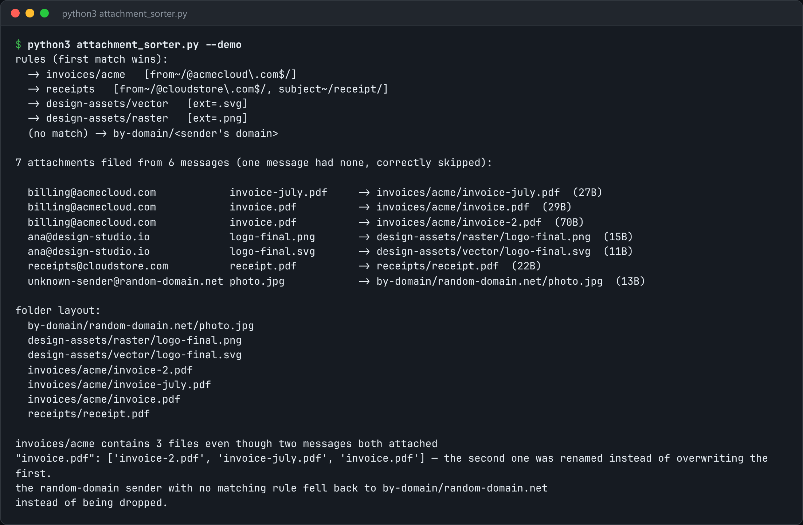

# Attachment Sorter

Watch a maildir, file every attachment by sender or rule, and log what happened.



*Real output of `python3 attachment_sorter.py --demo`.*

## Features

- Parses raw RFC 822 messages with the stdlib `email` package. If your mail is already a maildir, you don't need an IMAP client.
- Decodes attachments regardless of Content-Transfer-Encoding: base64, quoted-printable, or none.
- **First-match-wins rules** on sender and subject, with a **sender-domain fallback folder**, so nothing is silently dropped.
- Sanitises and **de-duplicates filenames**, so two `invoice.pdf` files from different emails don't overwrite each other.
- Logs where each attachment was filed.

## How it works

Each message is parsed, its attachment parts are walked, and each attachment is decoded. The rules are checked in order against the sender and subject. If none matches, the attachment goes into a folder named after the sender's domain.

## Usage

```bash
python3 attachment_sorter.py ~/Mail/INBOX --rules rules.json --into ~/Downloads/sorted
python3 attachment_sorter.py --demo
```

## Run it

```bash
python3 attachment_sorter.py --demo
```

Needs Python 3.10+ and nothing else: standard library only.

## Files

| File | Purpose |
| --- | --- |
| [`attachment_sorter.py`](attachment_sorter.py) | The complete program |
| [`preview.png`](preview.png) | Captured output of a real run |
