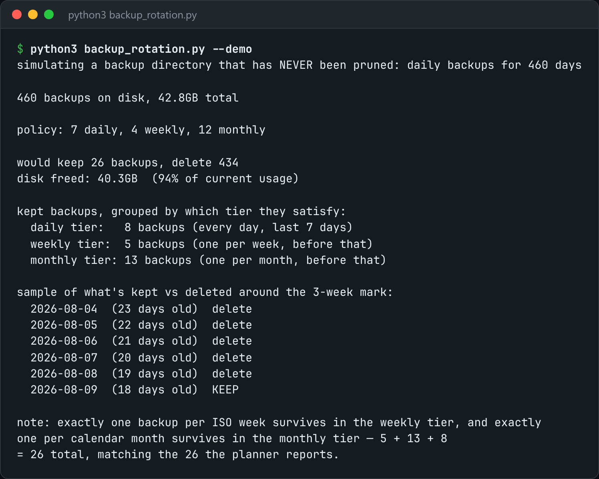

# Backup Rotation

Run nightly dumps and enforce a grandfather-father-son retention policy.



*Real output of `python3 backup_rotation.py --demo`.*

## Features

- **GFS retention**: daily backups for a short window, one per week for longer, and one per month for a long time.
- Decides which backups to keep **from their timestamps alone**, so it works whether the backups ran on a perfect schedule or with gaps.
- **Never deletes the backup a slot depends on** until a newer one has taken its place.
- A `run` subcommand that makes the dump and then prunes.

## How it works

Each retention tier (daily, weekly, monthly) claims the newest backup in each of its time buckets. Anything no tier claims is deleted. This avoids both keeping every backup forever and a flat "last N" window that loses your three-month-old restore point.

## Usage

```bash
python3 backup_rotation.py run --source ./data --dest ./backups
python3 backup_rotation.py --demo
```

## Run it

```bash
python3 backup_rotation.py --demo
```

Needs Python 3.10+ and nothing else: standard library only.

## Files

| File | Purpose |
| --- | --- |
| [`backup_rotation.py`](backup_rotation.py) | The complete program |
| [`preview.png`](preview.png) | Captured output of a real run |
