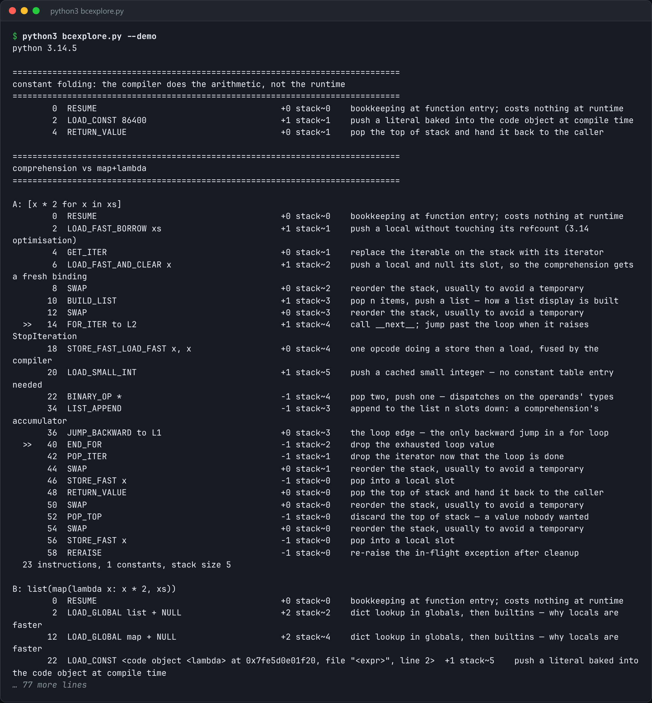

# Bytecode Explorer

Show the bytecode behind your Python, annotated, and diff two ways of writing the same thing.



*Real output of `python3 bcexplore.py --demo`.*

## Features

- Disassembles a **function in a module**, a **one-line expression**, or a **comparison of two expressions**.
- **Annotates each opcode** with what it does to the value stack. That is the part `dis` leaves out.
- A **side-by-side diff** of two spellings shows the extra function call or the constant that got folded at compile time.

## How it works

It uses the stdlib `dis` module and adds a table of stack effects and notes for each opcode. The compare mode lines up the instruction streams of both versions so the differences stand out.

## Usage

```bash
python3 bcexplore.py mymodule.py --function parse
python3 bcexplore.py --expr "sum(x*x for x in data)"
python3 bcexplore.py --compare "[x*2 for x in xs]" "list(map(lambda x: x*2, xs))"
python3 bcexplore.py --demo
```

## Run it

```bash
python3 bcexplore.py --demo
```

Needs Python 3.10+ and nothing else: standard library only.

## Files

| File | Purpose |
| --- | --- |
| [`bcexplore.py`](bcexplore.py) | The complete program |
| [`preview.png`](preview.png) | Captured output of a real run |
