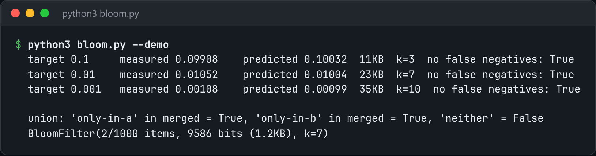

# Bloom Filter

A Bloom filter sized from the false-positive rate you ask for, then measured against reality.



*Real output of `python3 bloom.py --demo`.*

## Features

- Derives **bit count and hash count** from the target size and error rate: `m = -n*ln(p)/ln(2)^2`, `k = m/n*ln(2)`.
- **Kirsch-Mitzenmacher double hashing** (`g_i = h1 + i*h2`): one BLAKE2b digest stands in for k hash functions.
- The demo **measures the real false-positive rate** against the target.
- `build` and `query` subcommands with a compact on-disk format.

## How it works

One 128-bit BLAKE2b digest is split into two 64-bit halves, and the k bit positions are derived from them. The stride is forced odd so it covers the whole filter.

## Usage

```bash
python3 bloom.py --demo
python3 bloom.py build words.txt --error 0.001 --out words.bloom
python3 bloom.py query words.bloom hello world
```

## Run it

```bash
python3 bloom.py --demo
```

Needs Python 3.10+ and nothing else: standard library only.

## Files

| File | Purpose |
| --- | --- |
| [`bloom.py`](bloom.py) | The complete program |
| [`preview.png`](preview.png) | Captured output of a real run |
