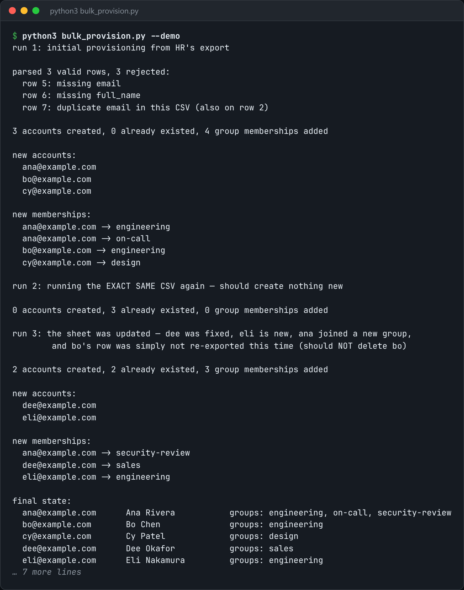

# Bulk Provisioning

Create accounts and group memberships from a CSV, idempotently.



*Real output of `python3 bulk_provision.py --demo`.*

## Features

- **Idempotent**: running the same CSV twice creates nothing the second time.
- Compares the CSV with existing accounts **by a stable key (email)** and inserts only what's missing.
- Group-membership changes are a **separate, additive** step.
- Removing a row **never deletes** an account, because a spreadsheet can't express a deliberate deletion.

## How it works

The CSV is compared with a SQLite users table. New emails become accounts, and any groups a user doesn't have yet are added. Nothing is ever removed, so a partial re-export can't delete anyone.

## Usage

```bash
python3 bulk_provision.py users.csv --db users.sqlite
python3 bulk_provision.py --demo
```

## Run it

```bash
python3 bulk_provision.py --demo
```

Needs Python 3.10+ and nothing else: standard library only.

## Files

| File | Purpose |
| --- | --- |
| [`bulk_provision.py`](bulk_provision.py) | The complete program |
| [`preview.png`](preview.png) | Captured output of a real run |
