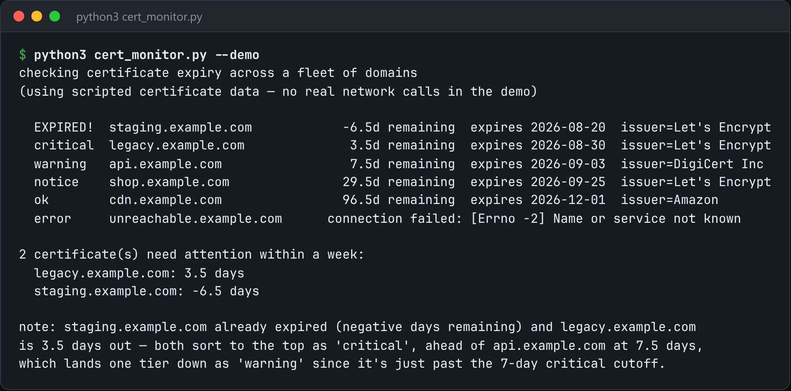

# TLS Certificate Monitor

Check TLS certificate expiry across many domains, warning at 30, 14 and 7 days out.



*Real output of `python3 cert_monitor.py --demo`.*

## Features

- Opens a **real TLS handshake** with stdlib `ssl` and `socket` and reads the peer certificate's `notAfter`.
- **Three severity levels**: 30 days is a heads-up, 14 is a ticket, 7 means paging someone.
- Sorts the most urgent certificates first and flags expired ones loudly.
- Reports an unreachable host as an error instead of a crash.

## How it works

Reading the certificate from a live handshake shows what a browser would actually see, rather than a cached value. Each domain's days remaining is mapped to a severity, and the list is sorted by urgency.

## Usage

```bash
python3 cert_monitor.py example.com api.example.com --port 443
python3 cert_monitor.py --demo
```

## Run it

```bash
python3 cert_monitor.py --demo
```

Needs Python 3.10+ and nothing else: standard library only.

## Files

| File | Purpose |
| --- | --- |
| [`cert_monitor.py`](cert_monitor.py) | The complete program |
| [`preview.png`](preview.png) | Captured output of a real run |
