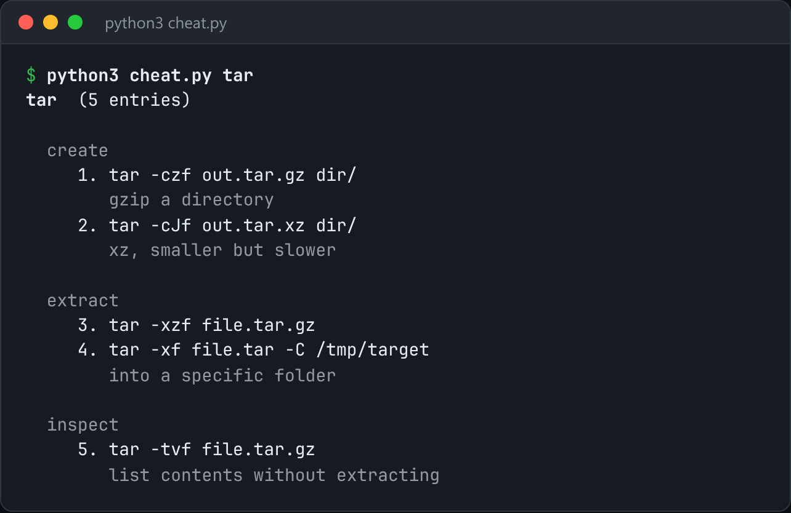

# Cheatsheets

Your own cheatsheets, one keystroke away, with the examples you actually use.



*Real output of `python3 cheat.py tar`.*

## Features

- Sheets are **plain markdown** in `~/.cheat`: a `## heading` starts a section, and each indented line is a numbered entry.
- **Ranked search** across every sheet with `--search`.
- `--copy <sheet> <n>` puts an entry on the **clipboard**.
- `edit` opens a sheet in `$EDITOR`, creating it from a template if needed.

## How it works

Sheets are parsed into (section, command, comment) entries. `# comment` lines directly above a command become its description, so a sheet stays readable in any editor.

## Usage

```bash
python3 cheat.py tar                 # show the sheet
python3 cheat.py --search rebase     # grep every sheet, ranked
python3 cheat.py edit ffmpeg         # open in $EDITOR (creates from a template)
python3 cheat.py --copy tar 3        # put entry 3 on the clipboard
```

## Run it

```bash
python3 cheat.py --help
```

Needs Python 3.10+ and nothing else: standard library only.

## Files

| File | Purpose |
| --- | --- |
| [`cheat.py`](cheat.py) | The complete program |
| [`preview.png`](preview.png) | Captured output of a real run |
