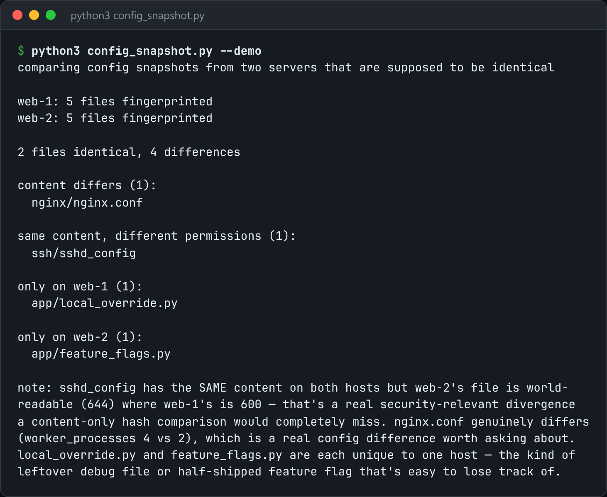

# Config Snapshot

Fingerprint config files across hosts and report anything that diverged.



*Real output of `python3 config_snapshot.py --demo`.*

## Features

- Hashes **file content, not mtime**, so a file that was touched but not changed doesn't count as drift.
- Records **permissions separately**: identical content with different mode bits is its own problem.
- `compare` reports exactly three kinds of drift: missing on one side, content differs, mode differs.
- Snapshots are plain JSON, so you can diff them between hosts.

## How it works

`snapshot` walks the directories and records a SHA-256 and mode for every file. `compare` loads two snapshots and sorts each path into one of the three drift categories.

## Usage

```bash
python3 config_snapshot.py snapshot /etc/nginx /etc/ssh --out host-a.json
python3 config_snapshot.py compare host-a.json host-b.json
python3 config_snapshot.py --demo
```

## Run it

```bash
python3 config_snapshot.py --demo
```

Needs Python 3.10+ and nothing else: standard library only.

## Files

| File | Purpose |
| --- | --- |
| [`config_snapshot.py`](config_snapshot.py) | The complete program |
| [`preview.png`](preview.png) | Captured output of a real run |
