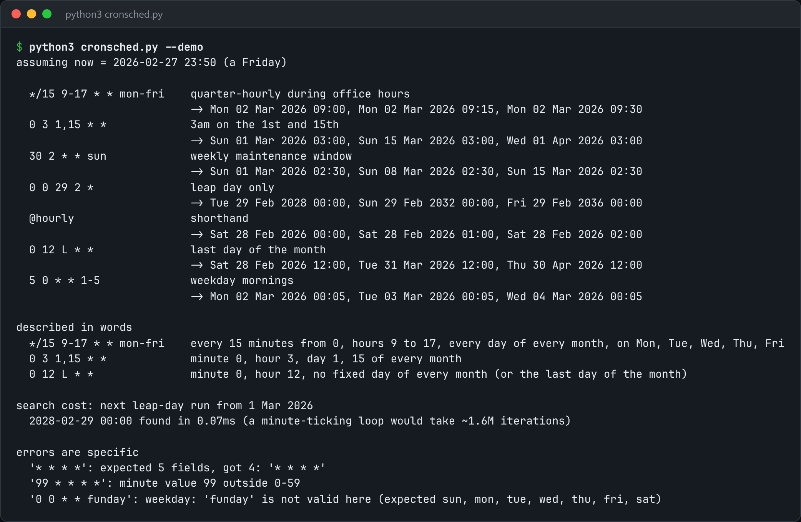

# Cron Scheduler

Parse cron expressions, compute the next runs, and fire jobs on time.



*Real output of `python3 cronsched.py --demo`.*

## Features

- Supports **steps** (`*/5`), **ranges**, **lists**, **names** (`mon`, `jan`), `@hourly`-style **shorthands** and **last-day-of-month** (`L`).
- **Field-by-field next-run search** skips whole months and days instead of ticking minute by minute, so "29 Feb" resolves instantly.
- `explain` turns an expression into plain English.
- `run` executes a jobs file of `<expr> <command>` lines.

## How it works

The search moves forward by the largest unit that fails to match (month, then day, hour, minute), so the work is bounded no matter how rare the schedule is. A naive search could need about 1.4 million iterations to find the next 29 Feb.

## Usage

```bash
python3 cronsched.py next "*/15 9-17 * * mon-fri" --count 5
python3 cronsched.py explain "0 3 1,15 * *"
python3 cronsched.py run jobs.txt          # lines of: <expr> <shell command>
python3 cronsched.py --demo
```

## Run it

```bash
python3 cronsched.py --demo
```

Needs Python 3.10+ and nothing else: standard library only.

## Files

| File | Purpose |
| --- | --- |
| [`cronsched.py`](cronsched.py) | The complete program |
| [`preview.png`](preview.png) | Captured output of a real run |
