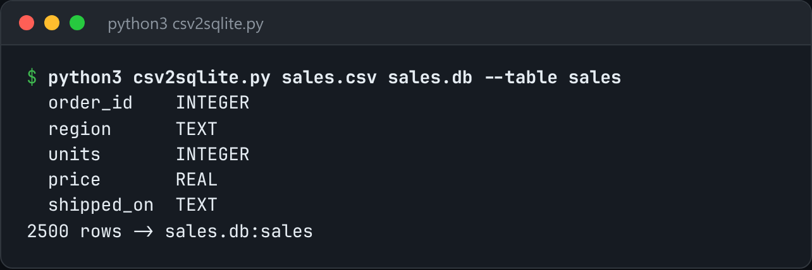

# CSV to SQLite

Import a CSV into SQLite, inferring column types from a sample of rows.



*Real output of importing a 2,500-row sample `sales.csv`.*

## Features

- **Type inference** from the first N rows: INTEGER if every value parses as one, REAL if all are numeric, otherwise TEXT.
- **Streams in batches**, so a 2 GB CSV never sits in memory.
- Sniffs the delimiter automatically, with a manual override.
- `--if-exists fail | replace | append`.

## How it works

A sample pass picks the column types and builds the `CREATE TABLE`. Then the file is streamed again and inserted in transactions of `--batch` rows.

## Usage

```bash
python3 csv2sqlite.py data.csv out.db --table sales
python3 csv2sqlite.py data.csv out.db --sample 5000 --if-exists replace
```

## Run it

```bash
python3 csv2sqlite.py --help
```

Needs Python 3.10+ and nothing else: standard library only.

## Files

| File | Purpose |
| --- | --- |
| [`csv2sqlite.py`](csv2sqlite.py) | The complete program |
| [`preview.png`](preview.png) | Captured output of a real run |
