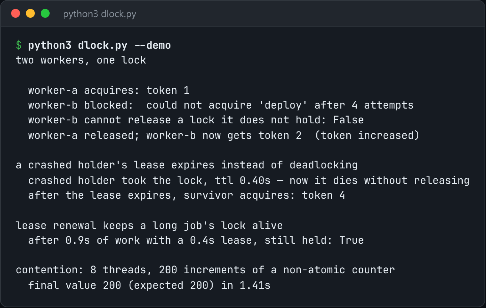

# Distributed Lock

A distributed lock with a fencing token, a renewable lease, and a safe release.



*Real output of `python3 dlock.py --demo`.*

## Features

- The lock value is a **unique owner id**, so you can only release a lock you still hold. The check is atomic.
- A **lease that expires**, so a dead holder can't deadlock the system, plus renewal for long jobs.
- A **monotonically increasing fencing token** on every acquisition.
- Works with an in-process backend or Redis, and can be used as a context manager.

## How it works

The fencing token is what makes a holder that paused and then resumed safe. Storage rejects writes carrying an older token, even if that holder still believes it owns the lock.

## Usage

```bash
python3 dlock.py --demo                          # runs against an in-process backend
python3 dlock.py acquire deploy --ttl 30 --redis localhost:6379
with DistributedLock(backend, "deploy") as lock: ...
```

## Run it

```bash
python3 dlock.py --demo
```

Needs Python 3.10+ and nothing else: standard library only.

## Files

| File | Purpose |
| --- | --- |
| [`dlock.py`](dlock.py) | The complete program |
| [`preview.png`](preview.png) | Captured output of a real run |
