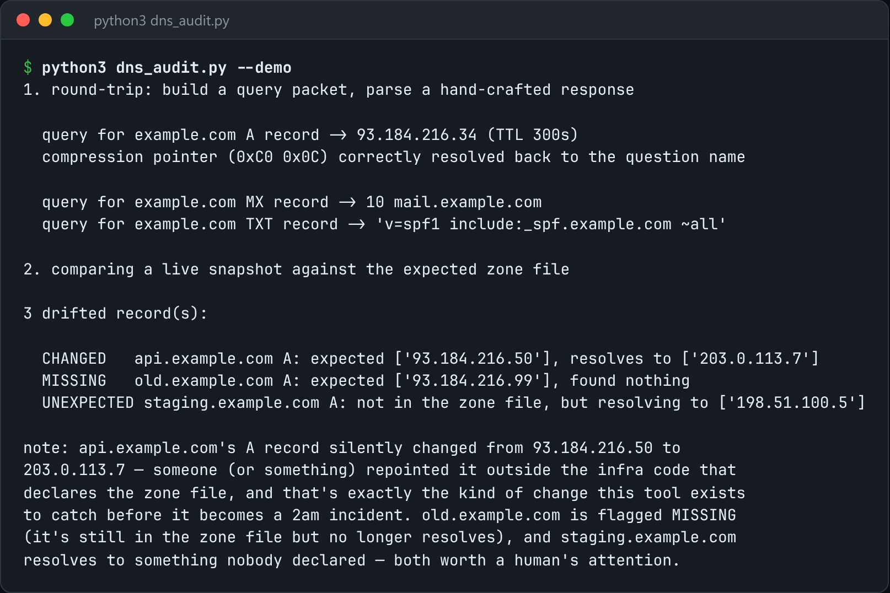

# DNS Audit

Snapshot DNS zones, diff them against expected records, and alert on drift.



*Real output of `python3 dns_audit.py --demo`.*

## Features

- Speaks **raw DNS over UDP** with stdlib `socket`, no dnspython.
- Builds the query packet by hand and parses the resource records in the response.
- Follows RFC 1035 **name-compression pointers**, the part most from-scratch parsers get wrong.
- Compares against an expected zone file to catch **records someone changed by hand** in a registrar UI.

## How it works

Queries are built with `struct`, and responses are decoded record by record. Name decoding follows compression pointers with a loop guard. The resulting records are compared with the declared zone.

## Usage

```bash
python3 dns_audit.py check --zone zone.json --domain example.com
python3 dns_audit.py --demo
```

## Run it

```bash
python3 dns_audit.py --demo
```

Needs Python 3.10+ and nothing else: standard library only.

## Files

| File | Purpose |
| --- | --- |
| [`dns_audit.py`](dns_audit.py) | The complete program |
| [`preview.png`](preview.png) | Captured output of a real run |
