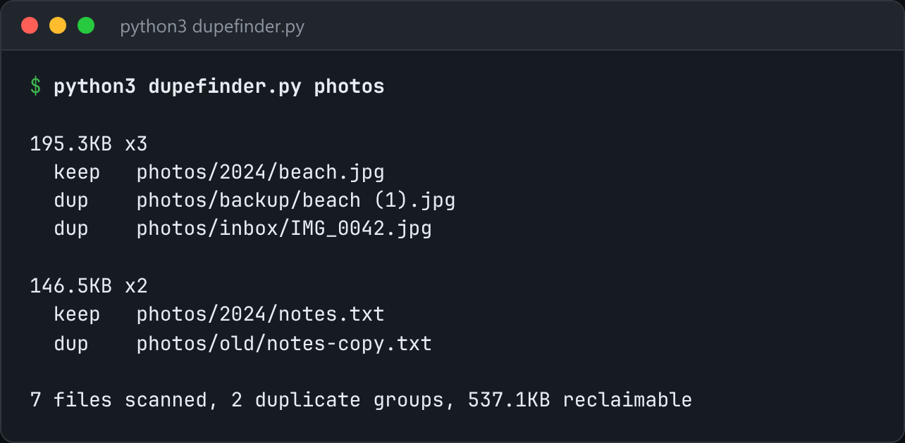

# Duplicate Finder

Find duplicate files the cheap way first: size, then a hash of the first 64 KB, then a full hash.



*Real output on a sample folder with a triple, a pair, and a same-size decoy: `python3 dupefinder.py photos`.*

## Features

- A **three-stage cascade**: one `stat()` per file, then a 64 KB head hash only for files of the same size, then a full hash only for head-hash matches.
- A folder of 50k photos needs only a few hundred full reads, not 50k.
- `--min-size`, `--follow-symlinks`, and `--delete` with `--keep oldest | newest | shortest-path`.

## How it works

Most candidate pairs are ruled out by size alone. Each later stage reads more bytes, but only for the files that survived the cheaper check.

## Usage

```bash
python3 dupefinder.py ~/Downloads
python3 dupefinder.py ~/Photos --min-size 1M --delete --keep oldest
```

## Run it

```bash
python3 dupefinder.py --help
```

Needs Python 3.10+ and nothing else: standard library only.

## Files

| File | Purpose |
| --- | --- |
| [`dupefinder.py`](dupefinder.py) | The complete program |
| [`preview.png`](preview.png) | Captured output of a real run |
