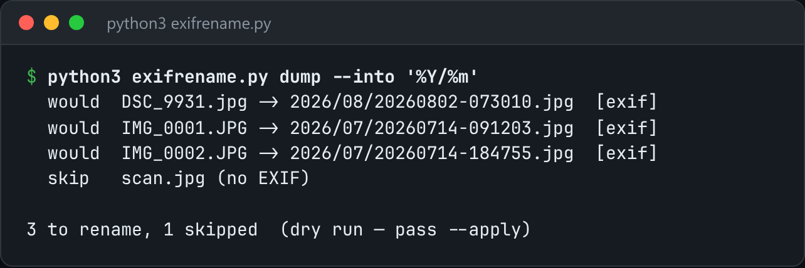

# EXIF Rename

Rename photos to their capture time, read straight from the JPEG's EXIF block.



*Real output on sample JPEGs with embedded EXIF timestamps (dry run): `python3 exifrename.py dump --into '%Y/%m'`.*

## Features

- **No Pillow**: walks the JPEG segments to APP1, then parses the TIFF header and IFD entries by hand.
- Reads tag **0x9003 DateTimeOriginal**.
- **Dry run by default**. `--apply` performs the renames, and `--into '%Y/%m'` sorts files into folders.
- Files without EXIF are skipped, unless you pass `--fallback-mtime`.

## How it works

The parser follows IFD0 to the Exif sub-IFD pointer and decodes the DateTimeOriginal ASCII value, honouring the TIFF byte order (`II` or `MM`).

## Usage

```bash
python3 exifrename.py ~/Pictures/dump                 # dry run, prints the plan
python3 exifrename.py ~/Pictures/dump --apply --into '%Y/%m'
```

## Run it

```bash
python3 exifrename.py --help
```

Needs Python 3.10+ and nothing else: standard library only.

## Files

| File | Purpose |
| --- | --- |
| [`exifrename.py`](exifrename.py) | The complete program |
| [`preview.png`](preview.png) | Captured output of a real run |
