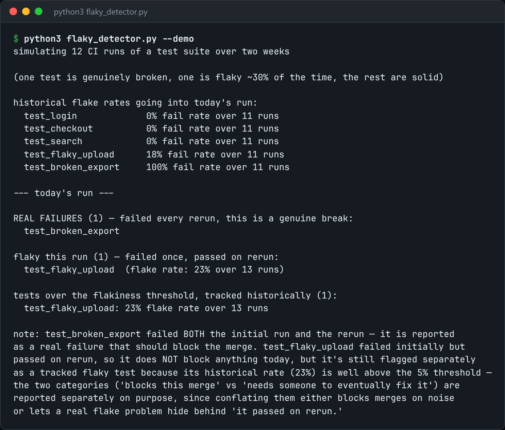

# Flaky Test Detector

Rerun failing tests, track flake rates over time, and flag what crosses a threshold.



*Real output of `python3 flaky_detector.py --demo`.*

## Features

- Runs the suite and **reruns only the tests that failed**.
- A fail-then-pass with no code change is recorded as a **flake**, not a failure.
- Keeps a **rolling pass/fail history** per test across runs.
- Flags tests whose flake rate crosses a threshold.

## How it works

The history file turns "this test fails sometimes" into a real number, such as 1 failure in 40 runs over two weeks, instead of a guess.

## Usage

```bash
python3 flaky_detector.py run --cmd "pytest tests/" --reruns 3
python3 flaky_detector.py --demo
```

## Run it

```bash
python3 flaky_detector.py --demo
```

Needs Python 3.10+ and nothing else: standard library only.

## Files

| File | Purpose |
| --- | --- |
| [`flaky_detector.py`](flaky_detector.py) | The complete program |
| [`preview.png`](preview.png) | Captured output of a real run |
