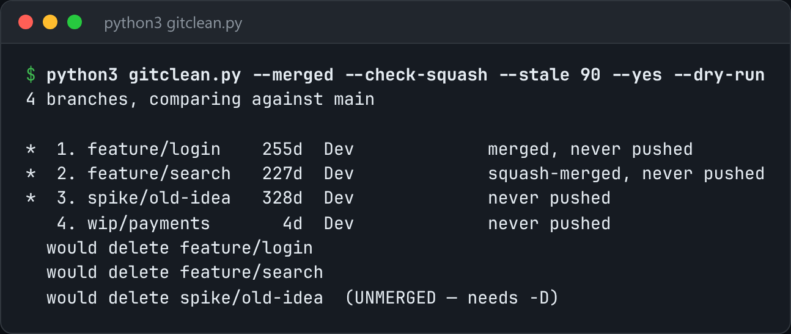

# Git Branch Cleaner

See every local branch with the facts you need, then delete the ones you choose.



*Real output on a sample repo with merged, squash-merged, stale and active branches: `python3 gitclean.py --merged --check-squash --stale 90 --yes --dry-run`.*

## Features

- Lists branches with their **age, author, upstream state and merge status**.
- Detects **squash-merged** branches by comparing their tree against the merge base. `git branch --merged` misses these.
- Preselects with `--merged`, `--stale N` or `--gone`, then either prompts you or deletes with `--yes`.
- `--dry-run` shows exactly what would be deleted, and labels unmerged branches that would need `-D`.

## How it works

For squash detection, it creates a temporary commit of the branch's tree on top of the merge base, then asks `git cherry` whether an equivalent change is already in the base branch.

## Usage

```bash
python3 gitclean.py                      # interactive: pick branches to delete
python3 gitclean.py --merged --yes       # non-interactive: drop everything already merged
python3 gitclean.py --stale 90 --dry-run
```

## Run it

```bash
python3 gitclean.py --help
```

Needs Python 3.10+ and nothing else: standard library only.

## Files

| File | Purpose |
| --- | --- |
| [`gitclean.py`](gitclean.py) | The complete program |
| [`preview.png`](preview.png) | Captured output of a real run |
