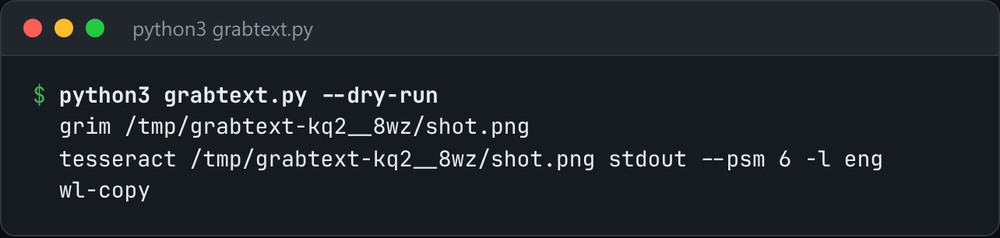

# Grab Text (OCR)

Select a region of the screen, OCR it, and put the text on your clipboard.



*Real `--dry-run` output on a Wayland session.*

## Features

- **Detects your desktop stack**: grim + slurp on Wayland, maim + slop on X11, `screencapture` on macOS.
- Pipes the capture through **tesseract** and copies the result with wl-copy, xclip or pbcopy.
- `--code` keeps line breaks and indentation. `--image` runs OCR on an existing file.
- Checks each dependency first and tells you exactly what to install.

## How it works

It builds a capture, OCR and clipboard pipeline from whatever tools are available. `--dry-run` prints that pipeline without running it.

## Usage

```bash
python3 grabtext.py                    # drag a box, text lands on the clipboard
python3 grabtext.py --image bug.png --lang eng+deu
python3 grabtext.py --code             # keep line breaks and indentation for code
python3 grabtext.py --dry-run          # print the pipeline it would run
```

## Run it

```bash
python3 grabtext.py --help
```

Needs Python 3.10+ and nothing else: standard library only.

## Files

| File | Purpose |
| --- | --- |
| [`grabtext.py`](grabtext.py) | The complete program |
| [`preview.png`](preview.png) | Captured output of a real run |
