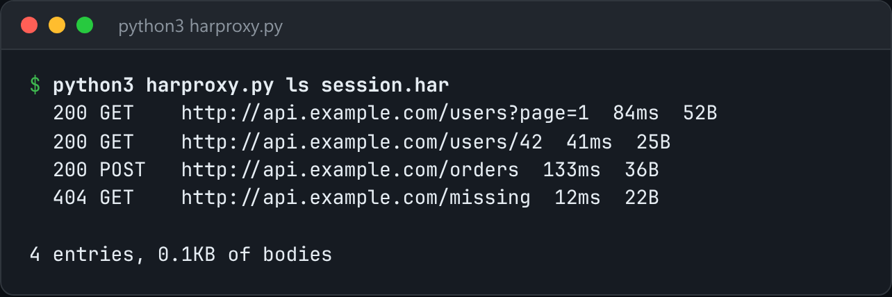

# HAR Proxy

A recording proxy: capture real traffic to a HAR file, then replay it offline.



*Real `ls` output on a captured session.*

## Features

- **Record mode** is a forward proxy that reads the absolute-form request line and writes both halves of each exchange to **HAR 1.2**.
- **Replay mode** serves captured responses, matching on **method + path + query**. `--ignore-query` relaxes the match.
- `ls` summarises a capture: method, status, URL and timing.

## How it works

Point any client at the proxy with `http_proxy=`, run your flow once, and then a test suite can run against yesterday's API with the network unplugged.

## Usage

```bash
python3 harproxy.py record --port 8080 --out session.har
    http_proxy=http://localhost:8080 curl http://example.com/api/users

python3 harproxy.py replay session.har --port 8081     # serves the captured responses
python3 harproxy.py ls session.har
```

## Run it

```bash
python3 harproxy.py --help
```

Needs Python 3.10+ and nothing else: standard library only.

## Files

| File | Purpose |
| --- | --- |
| [`harproxy.py`](harproxy.py) | The complete program |
| [`preview.png`](preview.png) | Captured output of a real run |
