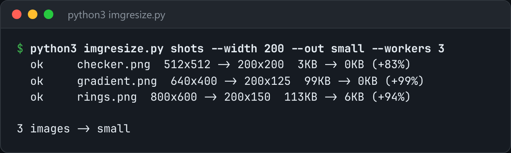

# PNG Batch Resizer

Resize a folder of PNGs in parallel, with the decoder, resampler and encoder all written from scratch.



*Real output resizing three generated PNGs to 200px wide: `python3 imgresize.py shots --width 200 --out small --workers 3`.*

## Features

- Decodes **all five PNG filter types** (None, Sub, Up, Average, Paeth).
- **Box and nearest-neighbour** resampling, with `--width`, `--height` or `--max` while preserving the aspect ratio.
- Re-encodes with a **filter chosen per scanline** by the minimum sum of absolute differences, the heuristic libpng uses.
- Runs in a **process pool** (`--workers`).

## How it works

A PNG is a header plus zlib-compressed scanlines, each prefixed with a filter byte that predicts pixels from the ones to the left and above. Decoding undoes the filters, and encoding picks the cheapest filter for each line before deflating.

## Usage

```bash
python3 imgresize.py ~/screenshots --width 800 --out ~/small
python3 imgresize.py ~/photos --max 1200 --filter box --workers 8
```

## Run it

```bash
python3 imgresize.py --help
```

Needs Python 3.10+ and nothing else: standard library only.

## Files

| File | Purpose |
| --- | --- |
| [`imgresize.py`](imgresize.py) | The complete program |
| [`preview.png`](preview.png) | Captured output of a real run |
