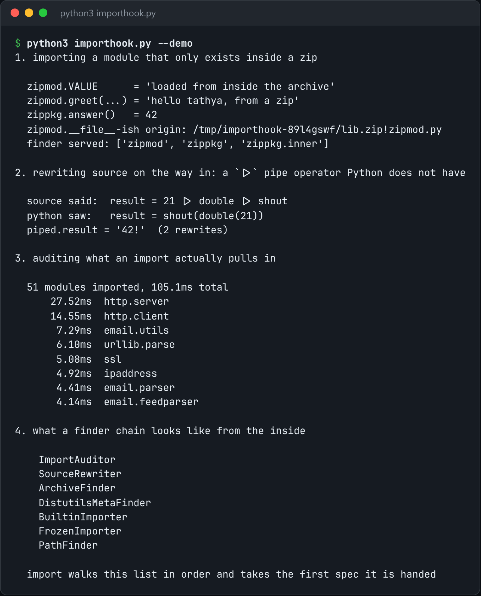

# Import Hooks

Custom import machinery: load modules from an archive, rewrite source on the way in, and audit imports.



*Real output of `python3 importhook.py --demo`.*

## Features

- A **finder + loader** on `sys.meta_path` that imports modules straight out of a zip archive.
- A **source-rewriting** loader that transforms code before it executes.
- An **audit hook** that records every import as it happens.

## How it works

A finder decides whether it can supply a module and returns a spec. A loader produces the source and executes it into the module's namespace. Once you've written one, `import` is just a loop over `sys.meta_path`.

## Usage

```bash
python3 importhook.py --demo
python -c "import importhook, mymodule"     # after install_archive('lib.zip')
```

## Run it

```bash
python3 importhook.py --demo
```

Needs Python 3.10+ and nothing else: standard library only.

## Files

| File | Purpose |
| --- | --- |
| [`importhook.py`](importhook.py) | The complete program |
| [`preview.png`](preview.png) | Captured output of a real run |
