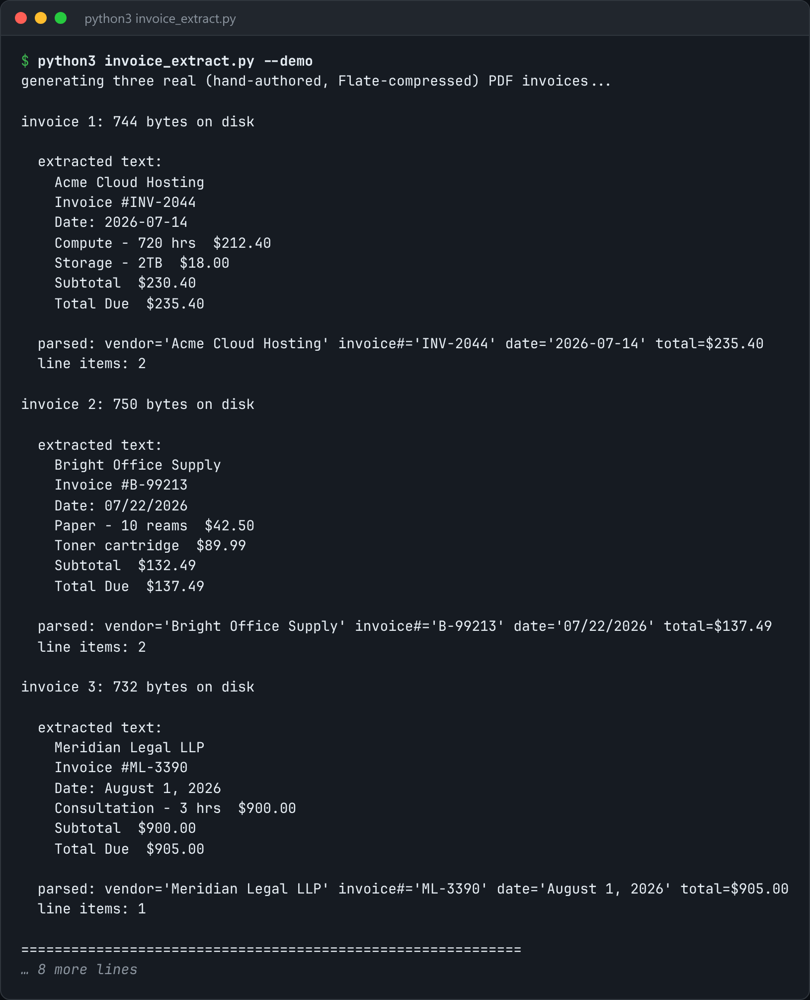

# Invoice Extractor

Pull totals, dates and line items out of PDF invoices into a reconciled spreadsheet.



*Real output of `python3 invoice_extract.py --demo`.*

## Features

- **No PyPDF2, no pdfplumber**: walks the PDF object table directly.
- Inflates content streams with zlib (**FlateDecode**).
- Rebuilds the **reading order** from the `Tm`/`Td` text-positioning operators.
- Runs total, date and vendor regexes over the rebuilt lines, and **reconciles** the line items against the stated total.

## How it works

A content stream is a small stack-based language. Only the text-positioning and text-showing operators matter here, and sorting fragments by position turns a bag of text into lines.

## Usage

```bash
python3 invoice_extract.py invoices/*.pdf --out report.csv
python3 invoice_extract.py --demo
```

## Run it

```bash
python3 invoice_extract.py --demo
```

Needs Python 3.10+ and nothing else: standard library only.

## Files

| File | Purpose |
| --- | --- |
| [`invoice_extract.py`](invoice_extract.py) | The complete program |
| [`preview.png`](preview.png) | Captured output of a real run |
