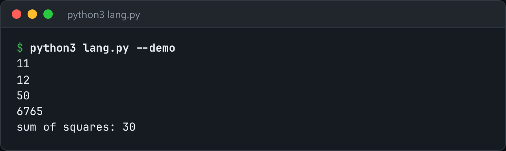

# Toy Language

A small language: tokenizer, Pratt parser, tree-walking evaluator, and real closures.



*Real output of `python3 lang.py --demo`.*

## Features

- A **Pratt parser** with all precedence in one `BINDING` table.
- `2 + 3 * 4 ^ 2` and `-x.y(1)` both parse correctly for the same reason, without a grammar rule per level.
- A **tree-walking evaluator** with lexical scope and **real closures**.
- `--ast` dumps the parse tree.

## How it works

Each token knows its prefix and infix behaviour and its binding power. The parser loops while the next operator binds more tightly than the current context.

## Usage

```bash
python3 lang.py program.toy
python3 lang.py --demo
python3 lang.py --ast program.toy      # dump the parse tree
```

## Run it

```bash
python3 lang.py --demo
```

Needs Python 3.10+ and nothing else: standard library only.

## Files

| File | Purpose |
| --- | --- |
| [`lang.py`](lang.py) | The complete program |
| [`preview.png`](preview.png) | Captured output of a real run |
