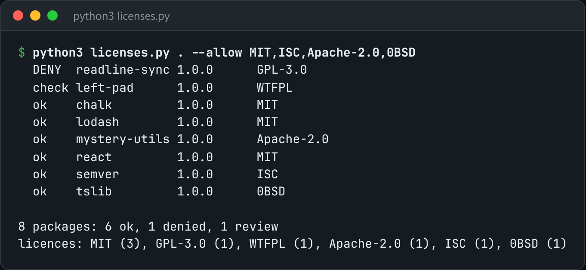

# License Audit

Walk an installed dependency tree and flag licences outside your allow list.



*Real output on a sample `node_modules` with a GPL package and an undeclared Apache licence.*

## Features

- Reads **what is actually installed** (`node_modules` or Python distributions), not what the manifest asks for.
- `--allow` and `--deny` lists of SPDX ids. Copyleft licences are denied by default.
- Falls back to **fingerprinting the LICENSE text** when a package declares no licence.
- Writes a full report with `--json`, and exits non-zero when something needs attention.

## How it works

The transitive dependency that pulled in a copyleft licence is never the one you wrote down, so it scans the installed tree. Packages without metadata are classified by matching their LICENSE text.

## Usage

```bash
python3 licenses.py node_modules --allow MIT,ISC,Apache-2.0,BSD-2-Clause,BSD-3-Clause
python3 licenses.py . --python --deny GPL-3.0,AGPL-3.0 --json report.json
```

## Run it

```bash
python3 licenses.py --help
```

Needs Python 3.10+ and nothing else: standard library only.

## Files

| File | Purpose |
| --- | --- |
| [`licenses.py`](licenses.py) | The complete program |
| [`preview.png`](preview.png) | Captured output of a real run |
