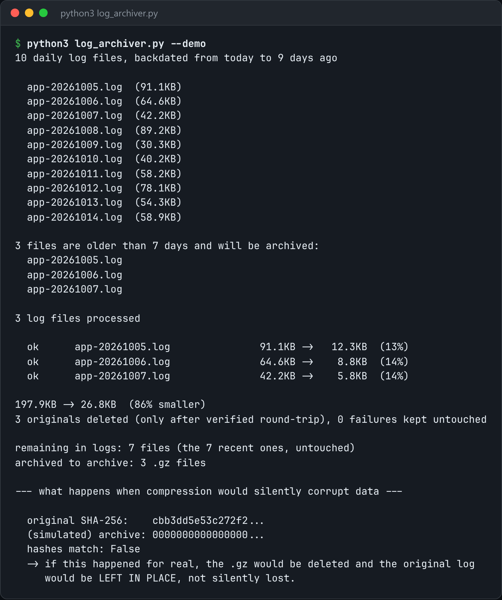

# Log Archiver

Roll, compress and ship old logs to cold storage, with a verified checksum.



*Real output of `python3 log_archiver.py --demo`.*

## Features

- Archives logs older than `--older-than` days into `--dest`.
- Takes a **SHA-256 of the original** before compressing.
- **Decompresses the archive back into memory** and compares the hashes.
- Deletes the original **only after a byte-for-byte match**. A log that fails verification stays in place.

## How it works

Verification is the step everyone skips. A gzip that silently corrupted a file is otherwise discovered during the incident, when you need that log most.

## Usage

```bash
python3 log_archiver.py /var/log/app --older-than 7 --dest ./archive
python3 log_archiver.py --demo
```

## Run it

```bash
python3 log_archiver.py --demo
```

Needs Python 3.10+ and nothing else: standard library only.

## Files

| File | Purpose |
| --- | --- |
| [`log_archiver.py`](log_archiver.py) | The complete program |
| [`preview.png`](preview.png) | Captured output of a real run |
