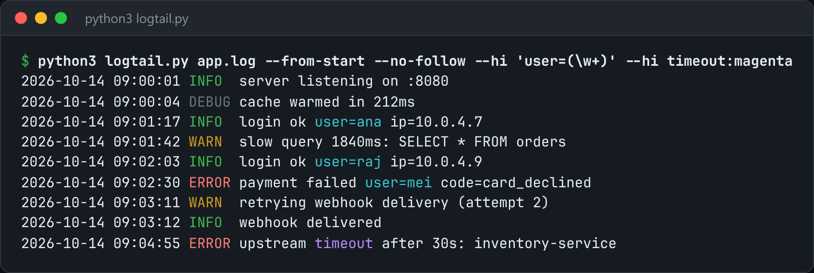

# Log Tail

Follow a log file and colour it by level, with your own highlight rules.



*Real output (`--no-follow`) on a sample application log.*

## Features

- **Colours by level**: DEBUG, INFO, WARN, ERROR.
- `--hi REGEX[:colour]` adds your own highlight rules.
- `--only WARN,ERROR` and `--grep` filters.
- **Survives log rotation**: when the inode at the path changes, it reopens the new file.
- Reads from stdin with `-`.

## How it works

Instead of tailing a deleted file handle forever, it watches the inode at the path and reopens the file after rotation.

## Usage

```bash
python3 logtail.py /var/log/app.log
python3 logtail.py app.log --hi 'user=(\w+)' --hi ERROR:red --only WARN,ERROR
cat app.log | logtail.py -
```

## Run it

```bash
python3 logtail.py --help
```

Needs Python 3.10+ and nothing else: standard library only.

## Files

| File | Purpose |
| --- | --- |
| [`logtail.py`](logtail.py) | The complete program |
| [`preview.png`](preview.png) | Captured output of a real run |
