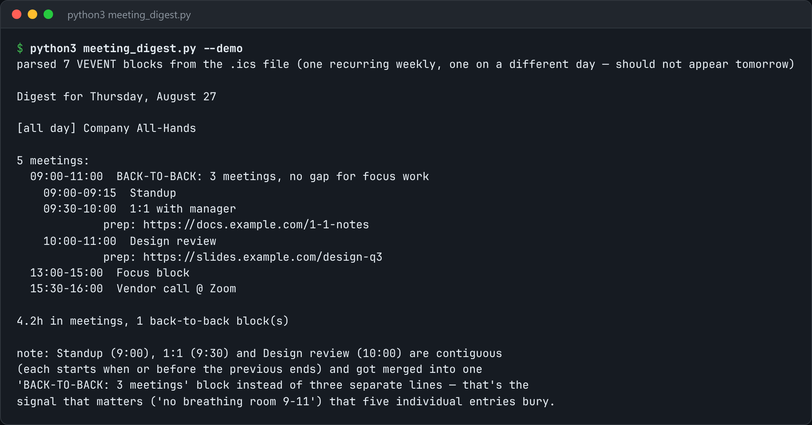

# Meeting Digest

Summarise tomorrow's calendar into one message, with prep links attached.



*Real output of `python3 meeting_digest.py --demo`.*

## Features

- Reads a **real `.ics` file** with the stdlib only. It unfolds RFC 5545 line continuations.
- Expands simple **RRULEs** (daily and weekly) far enough to find tomorrow's occurrences.
- **Groups back-to-back meetings into blocks** ("focus is gone from 9 to 11am").
- Adds a one-line prep note per meeting from the attendee count and any URL in the description.

## How it works

VEVENT blocks are parsed, recurring events are expanded, and tomorrow's events are merged into contiguous blocks. Five 30-minute meetings in a row read as one interruption, not five.

## Usage

```bash
python3 meeting_digest.py calendar.ics
python3 meeting_digest.py --demo
```

## Run it

```bash
python3 meeting_digest.py --demo
```

Needs Python 3.10+ and nothing else: standard library only.

## Files

| File | Purpose |
| --- | --- |
| [`meeting_digest.py`](meeting_digest.py) | The complete program |
| [`preview.png`](preview.png) | Captured output of a real run |
