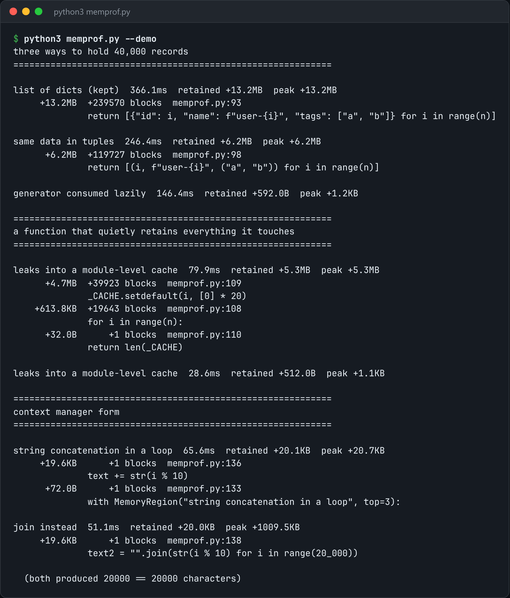

# Memory Profiler

Attribute memory growth to the line that caused it, with a decorator.



*Real output of `python3 memprof.py --demo`.*

## Features

- An `@profile_memory(top=5)` **decorator** for a single function.
- `memprof.py script.py` profiles a **whole script**.
- Diffs tracemalloc snapshots, **filtered to your own code** and sorted by growth.
- `--retained` runs `gc.collect()` first, so you see what stayed alive.

## How it works

tracemalloc gives you allocation snapshots. The useful part is the diff between before and after, with the stdlib and site-packages filtered out.

## Usage

```bash
@profile_memory(top=5)
def load(): ...

python3 memprof.py --demo
python3 memprof.py script.py --top 10       # profile a whole script
```

## Run it

```bash
python3 memprof.py --demo
```

Needs Python 3.10+ and nothing else: standard library only.

## Files

| File | Purpose |
| --- | --- |
| [`memprof.py`](memprof.py) | The complete program |
| [`preview.png`](preview.png) | Captured output of a real run |
