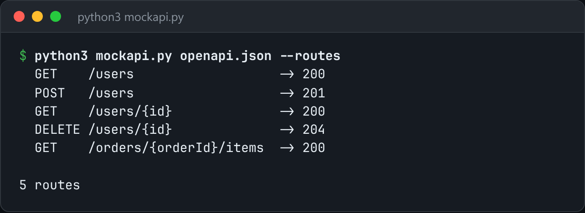

# Mock API

Turn an OpenAPI spec into a running mock API, with latency and failures on demand.



*Real `--routes` output for a sample OpenAPI document.*

## Features

- Responses come from the spec: an operation's `example`, or a value **synthesised from the schema**.
- Synthesis respects `type`, `enum`, `format`, `required` and `$ref`.
- **Path parameters are matched by shape**: `/users/{id}` answers `/users/42`.
- `--latency`, `--jitter` and `--fail-rate`, with a `--seed` for reproducible failures.

## How it works

Each path template is compiled to a matcher. A request finds its operation and gets a response built from the 2xx schema.

## Usage

```bash
python3 mockapi.py openapi.json --port 4010
python3 mockapi.py openapi.json --latency 120 --fail-rate 0.1 --seed 7
python3 mockapi.py openapi.json --routes          # list what it would serve
```

## Run it

```bash
python3 mockapi.py --help
```

Needs Python 3.10+ and nothing else: standard library only.

## Files

| File | Purpose |
| --- | --- |
| [`mockapi.py`](mockapi.py) | The complete program |
| [`preview.png`](preview.png) | Captured output of a real run |
