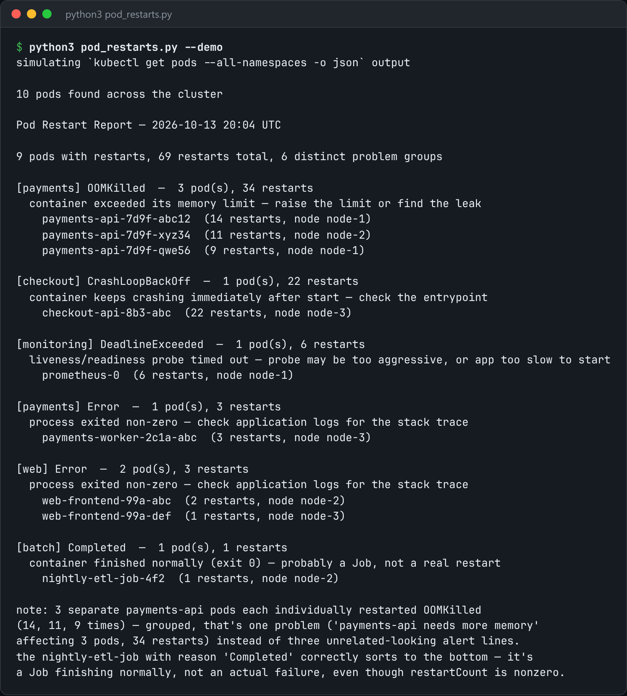

# Pod Restart Report

Query a Kubernetes cluster for restart loops and post a ranked daily summary.



*Real output of `python3 pod_restarts.py --demo`.*

## Features

- Calls `kubectl get pods -o json` directly, with no client library.
- Ranks pods by restart count and **groups them by namespace and reason**.
- Tells **OOMKilled**, **liveness-probe timeouts** and **plain crashes** apart, because each needs a different fix.
- Turns "43 pods restarted" into "3 real problems, each affecting N pods".

## How it works

The last-termination reason of each container is grouped by (namespace, reason). Each group is printed with a hint about what kind of fix it usually needs.

## Usage

```bash
python3 pod_restarts.py --context prod --namespace default
python3 pod_restarts.py --demo
```

## Run it

```bash
python3 pod_restarts.py --demo
```

Needs Python 3.10+ and nothing else: standard library only.

## Files

| File | Purpose |
| --- | --- |
| [`pod_restarts.py`](pod_restarts.py) | The complete program |
| [`preview.png`](preview.png) | Captured output of a real run |
