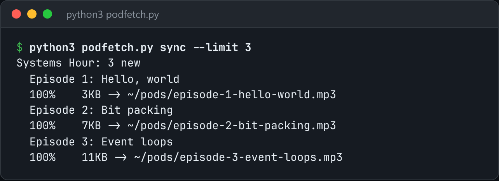

# Podcast Fetcher

Subscribe to podcast feeds, fetch new episodes, and tag the files as you go.



*Real `sync` output against a local sample feed.*

## Features

- `add`, `sync` and `ls` subcommands over a small subscription store.
- **Resumes downloads** with an HTTP Range request when a partial file is left behind.
- Writes **ID3v2.4 tags** from the feed: title, show, date and episode.
- Gives files readable names, so players show more than "track01".

## How it works

The RSS feed is parsed with ElementTree, new enclosures are downloaded (resuming any partial file), and an ID3v2.4 frame block is prepended to each MP3.

## Usage

```bash
python3 podfetch.py add https://example.com/feed.xml --into ~/Podcasts
python3 podfetch.py sync --limit 3
python3 podfetch.py ls
```

## Run it

```bash
python3 podfetch.py --help
```

Needs Python 3.10+ and nothing else: standard library only.

## Files

| File | Purpose |
| --- | --- |
| [`podfetch.py`](podfetch.py) | The complete program |
| [`preview.png`](preview.png) | Captured output of a real run |
