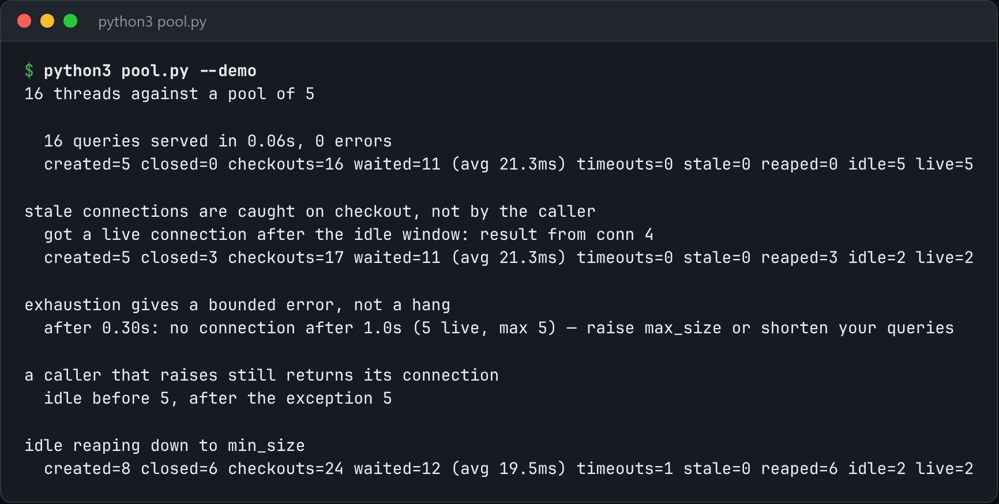

# Connection Pool

A connection pool that behaves under load: checkout timeouts, health checks, idle reaping.



*Real output of `python3 pool.py --demo`.*

## Features

- A **bounded checkout wait**, so an exhausted pool raises a clear error instead of blocking forever.
- **Validate on checkout**, so you never get a connection the server already closed.
- A **context manager**, so a raising caller can't leak a connection.
- An **idle reaper thread with a floor**, so 200 idle sockets don't stay open all night.

## How it works

A condition variable guards the free list. Checkout waits with a deadline, health-checks the connection cheaply, and replaces dead ones. The reaper closes idle connections above the minimum.

## Usage

```bash
python3 pool.py --demo
```

## Run it

```bash
python3 pool.py --demo
```

Needs Python 3.10+ and nothing else: standard library only.

## Files

| File | Purpose |
| --- | --- |
| [`pool.py`](pool.py) | The complete program |
| [`preview.png`](preview.png) | Captured output of a real run |
