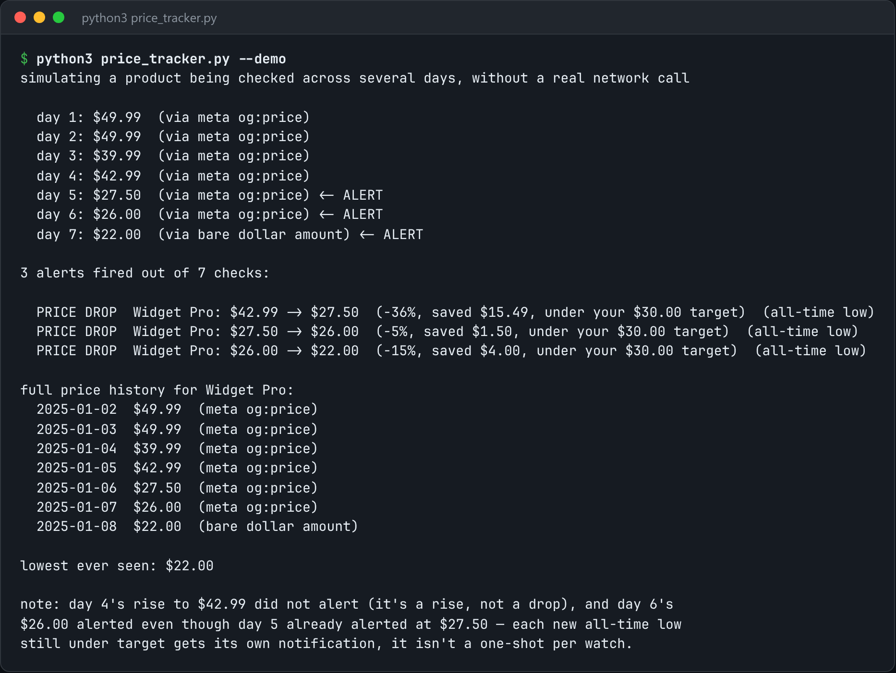

# Price Tracker

Scrape the prices of products you watch, and notify only on a real drop.



*Real output of `python3 price_tracker.py --demo`.*

## Features

- **Chained extractors**: JSON-LD, then meta tags, then `itemprop`, then a "$24.99 near the word price" heuristic.
- Keeps the first **plausible** number.
- Alerts only when the price is **below both the last recorded price and your target**.
- `add` and `check` subcommands with stored history.

## How it works

Every store marks up prices differently, so it tries several strategies in order. Alerting needs both conditions, so a price that just fluctuates while still too expensive never fires.

## Usage

```bash
python3 price_tracker.py add "https://shop.example.com/widget" --target 24.99
python3 price_tracker.py check
python3 price_tracker.py --demo
```

## Run it

```bash
python3 price_tracker.py --demo
```

Needs Python 3.10+ and nothing else: standard library only.

## Files

| File | Purpose |
| --- | --- |
| [`price_tracker.py`](price_tracker.py) | The complete program |
| [`preview.png`](preview.png) | Captured output of a real run |
