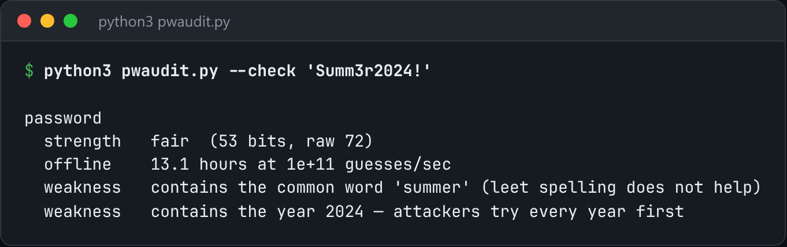

# Password Audit

Rate passwords the way an attacker would, entirely offline.



*Real output of `--check` on a typical "strong-looking" password.*

## Features

- **Strips leetspeak** substitutions before scoring.
- Finds **keyboard runs** like `qwerty` and `1qaz2wsx`, plus repeated and sequential blocks.
- Prices what remains as a **search space in guesses**, with a time-to-crack at `--rate` guesses per second.
- Checks breaches against a **local SHA-1 prefix file**. Nothing leaves the machine.
- Works on a single password (`--check`) or a whole password-manager CSV.

## How it works

Predictable patterns are removed or counted as cheap guesses, and the remainder is costed by character classes. That scores real guessability rather than "one symbol required".

## Usage

```bash
python3 pwaudit.py --check 'Summ3r2024!'
python3 pwaudit.py vault.csv --column password --breached breached-sha1.txt
```

## Run it

```bash
python3 pwaudit.py --help
```

Needs Python 3.10+ and nothing else: standard library only.

## Files

| File | Purpose |
| --- | --- |
| [`pwaudit.py`](pwaudit.py) | The complete program |
| [`preview.png`](preview.png) | Captured output of a real run |
