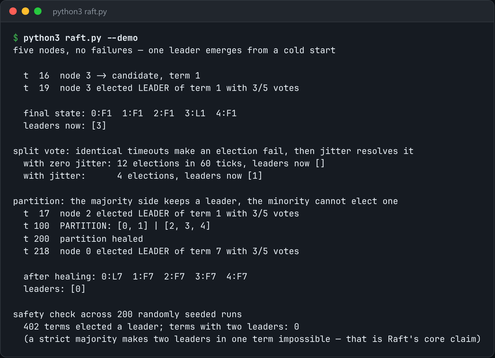

# Raft Elections

Raft leader election, simulated: terms, votes, heartbeats, and partitions you cause.



*Real output of `python3 raft.py --demo`.*

## Features

- **Randomised election timeouts** break symmetry, so split votes resolve.
- A candidate needs a **strict majority**, so two leaders can't coexist in one term.
- Any node that sees a **higher term steps down** at once. That rule alone makes a healed partition converge.
- `--partition START:END` cuts the cluster during a time window. `--seed` makes runs reproducible.

## How it works

A tick-based simulation of N nodes passing messages. Only the election half of Raft is modelled (no log replication), because that is where the subtle parts live.

## Usage

```bash
python3 raft.py --demo
python3 raft.py --nodes 5 --ticks 400 --partition 120:200 --seed 3
```

## Run it

```bash
python3 raft.py --demo
```

Needs Python 3.10+ and nothing else: standard library only.

## Files

| File | Purpose |
| --- | --- |
| [`raft.py`](raft.py) | The complete program |
| [`preview.png`](preview.png) | Captured output of a real run |
