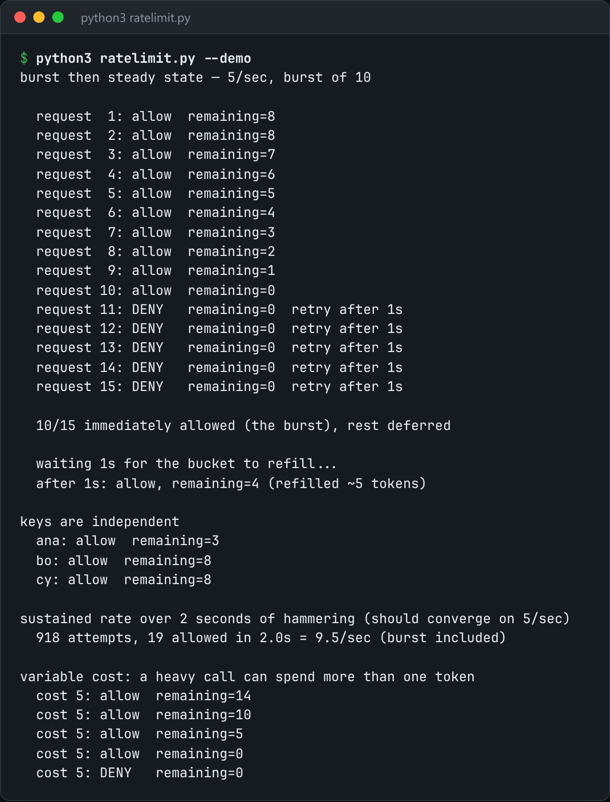

# Rate Limiter

Token-bucket rate limiting with the headers clients need to back off.



*Real output of `python3 ratelimit.py --demo`.*

## Features

- A **continuously refilling** bucket: no ticker thread and no fixed windows.
- A quiet caller can spend a **burst**, and a steady caller gets exactly `rate` per second.
- Rejections carry **RateLimit-Remaining**, **RateLimit-Reset** and **Retry-After**.
- `serve` runs a small HTTP server that applies the limiter.

## How it works

The bucket stores its token count and last-update time, and refills lazily on each request. Without the headers, a 429 just tells a client to guess.

## Usage

```bash
python3 ratelimit.py --demo
python3 ratelimit.py serve --port 8099 --rate 5 --burst 10
```

## Run it

```bash
python3 ratelimit.py --demo
```

Needs Python 3.10+ and nothing else: standard library only.

## Files

| File | Purpose |
| --- | --- |
| [`ratelimit.py`](ratelimit.py) | The complete program |
| [`preview.png`](preview.png) | Captured output of a real run |
