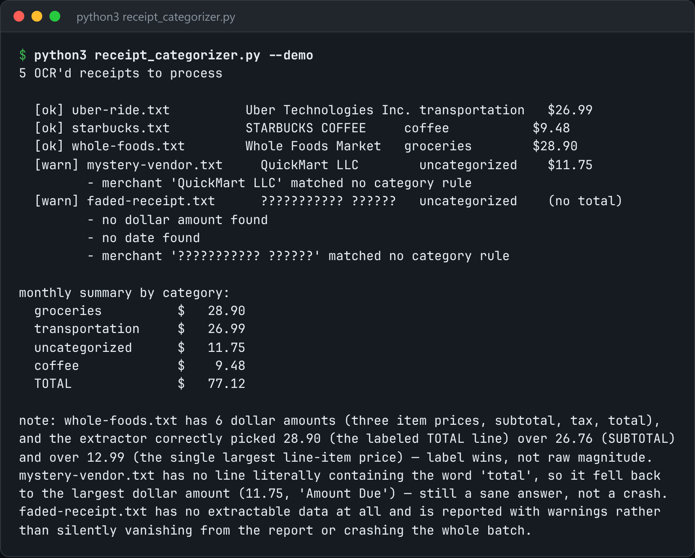

# Receipt Categorizer

Categorise receipts by merchant rules and export a monthly report.



*Real output of `python3 receipt_categorizer.py --demo`.*

## Features

- Works on receipt **text**, the output an OCR pass would produce.
- Finds the **real total** on a page that also lists a subtotal, tax and tip.
- Categorises by **merchant rules** with a sensible fallback instead of dropping the receipt.
- Writes a per-month CSV report.

## How it works

Labelled amounts are ranked (total over subtotal over tax), with a positional fallback. The merchant line is matched against category rules.

## Usage

```bash
python3 receipt_categorizer.py receipts/*.txt --month 2026-08 --out report.csv
python3 receipt_categorizer.py --demo
```

## Run it

```bash
python3 receipt_categorizer.py --demo
```

Needs Python 3.10+ and nothing else: standard library only.

## Files

| File | Purpose |
| --- | --- |
| [`receipt_categorizer.py`](receipt_categorizer.py) | The complete program |
| [`preview.png`](preview.png) | Captured output of a real run |
