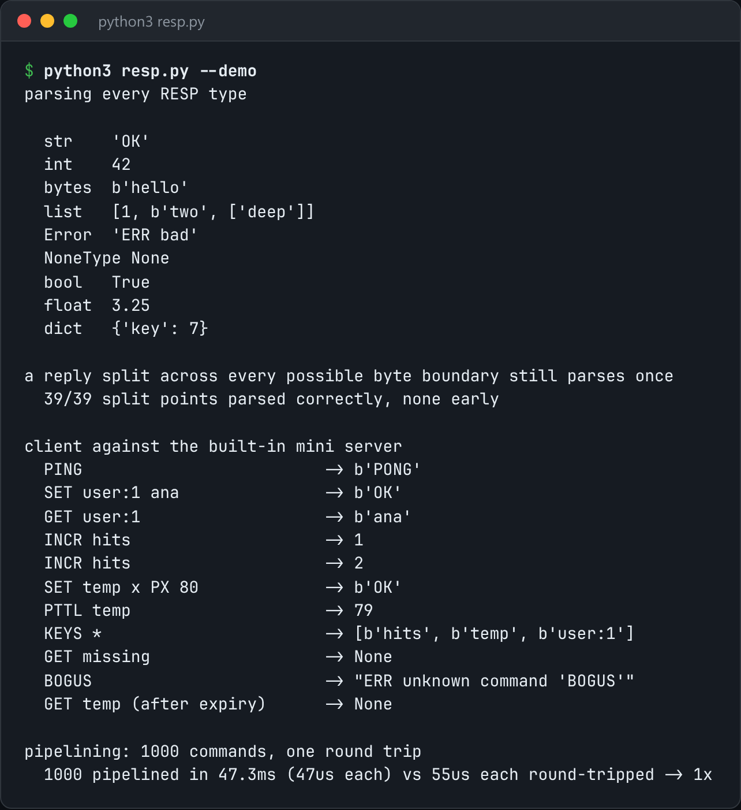

# RESP (Redis Protocol)

Speak Redis: an incremental RESP2/RESP3 parser, a client, and a tiny server to test against.



*Real output of `python3 resp.py --demo`.*

## Features

- An **incremental parser**: feed it any bytes and it yields complete values, keeping the partial tail.
- Handles replies split across **any byte boundary**, including the middle of a length prefix.
- A client (`client ... PING`) and a **mini Redis server** with GET, SET, DEL, INCR, EXPIRE and KEYS.
- The demo runs the server and client together, so no Redis is needed.

## How it works

The parser keeps a buffer and a cursor, and gives up cleanly when a value is incomplete. That is the bug most hand-written `recv()` loops have.

## Usage

```bash
python3 resp.py --demo                       # server + client, no Redis required
python3 resp.py client --host localhost --port 6379 PING
python3 resp.py serve --port 6380            # a mini Redis: GET/SET/DEL/INCR/EXPIRE/KEYS
```

## Run it

```bash
python3 resp.py --demo
```

Needs Python 3.10+ and nothing else: standard library only.

## Files

| File | Purpose |
| --- | --- |
| [`resp.py`](resp.py) | The complete program |
| [`preview.png`](preview.png) | Captured output of a real run |
