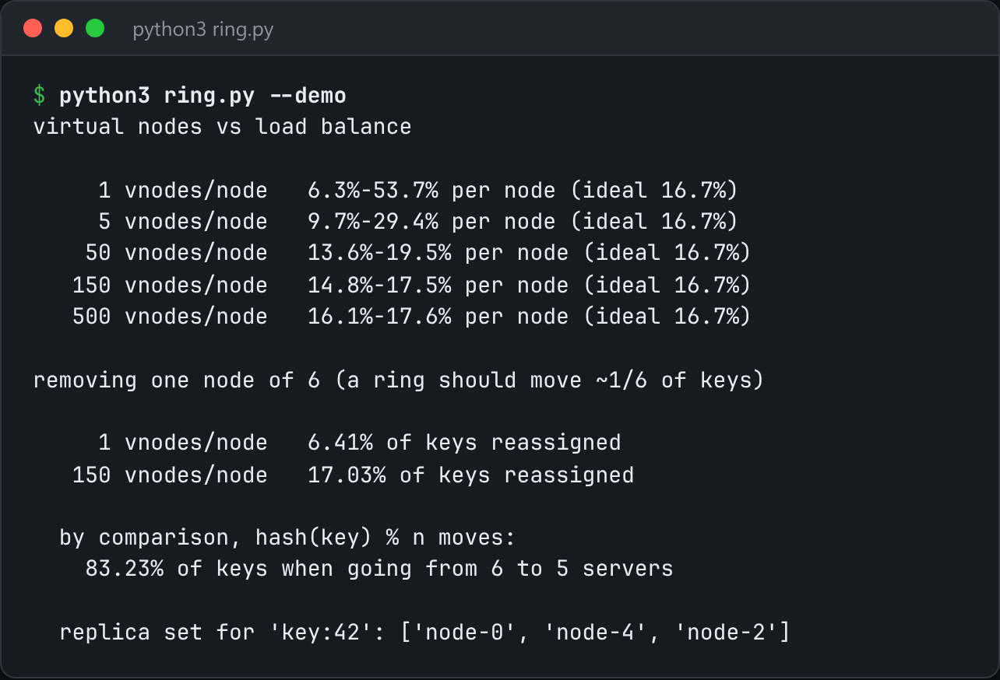

# Consistent Hash Ring

A consistent hash ring, and proof that removing a node barely moves any keys.



*Real output of `python3 ring.py --demo`.*

## Features

- **150+ virtual nodes per server** smooth the load to within a few percent.
- **Removing a server only reassigns its own share**, and the demo measures this instead of asserting it.
- `--nodes`, `--vnodes`, `--keys` and `--remove` let you test your own setup.

## How it works

Each server is hashed onto the ring many times. A key belongs to the next point clockwise, found by binary search. With a single point per server, random points cluster and the load is wildly uneven.

## Usage

```bash
python3 ring.py --demo
python3 ring.py --nodes 8 --vnodes 200 --keys 100000 --remove node-3
```

## Run it

```bash
python3 ring.py --demo
```

Needs Python 3.10+ and nothing else: standard library only.

## Files

| File | Purpose |
| --- | --- |
| [`ring.py`](ring.py) | The complete program |
| [`preview.png`](preview.png) | Captured output of a real run |
